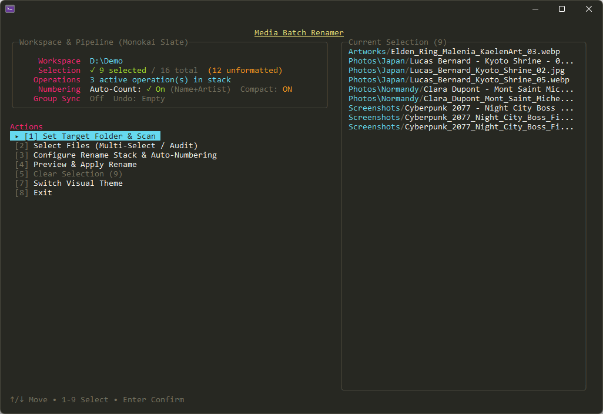
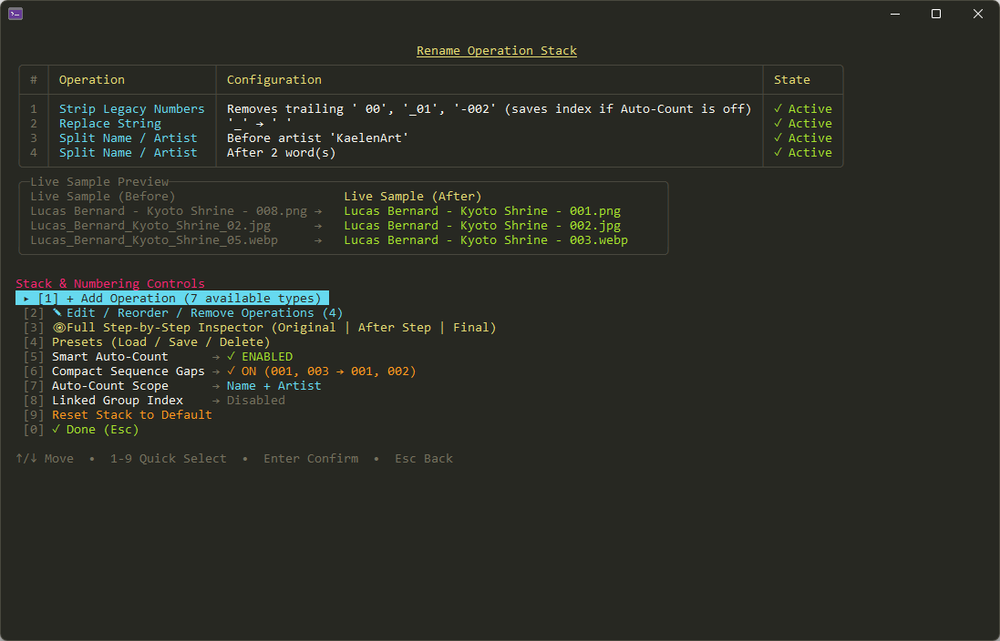
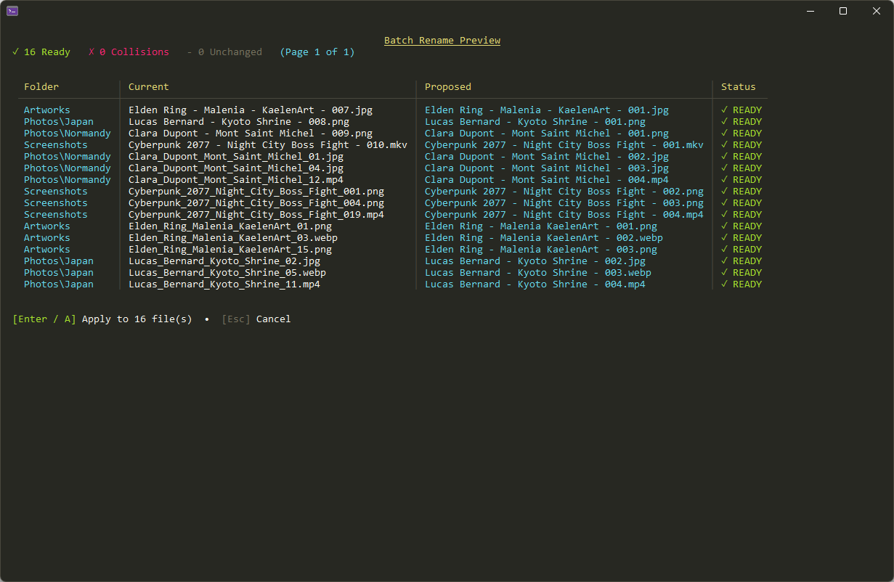

# MediaRenamer

  

A terminal-based batch file renamer built with C# .NET 8 and `Spectre.Console`. It started out as a quick utility to help me organize and rename my personal photo, screenshot and fan-art/reference library, before growing into a structured small project with composable pipelines, cross-folder sequence numbering, and atomic file operations.

> **Transparency Note:** AI was used during development, particularly in the early stages of the project (before it started to get cool) to speed up prototyping, as well as to help generate this README and the architecture diagrams.
 


## Why Use This?

Downloaded media archives quickly turn into an inconsistent mix of naming conventions: underscores instead of spaces, inverted artist/character segments, duplicate sequence numbers, and scattered subfolder structures. Standard bulk renamers make it easy to run one regex pass, but hard to chain multi-step transformations safely while keeping sequence numbers synchronized across separate folders.

MediaRenamer solves this by treating renaming as a deterministic, inspectable pipeline:

[Raw Files] -> [Operation Stack] -> [Cross-Folder Numbering] -> [Collision Check] -> [Atomic Rename]
|                        |                          |
(Step Snapshots)        (Scoped Indexing)           (2-Phase Commit)


Every rule executes in sequence, records an intermediate snapshot after each step, checks for disk conflicts before touching a single file, and stages moves through temporary filenames so circular swaps (`001` <-> `002`) never fail.

> **Note** The MediaRenamer is based on my naming convention for media and  to rename game art and screenshot, so it may not be practical for your usage.

## Features

- **Composable Operation Stack:** Chain, reorder, toggle, and save multi-step pipelines (Regex/Literal Replace, Split Name & Artist, Add Prefix/Suffix, Case Transform, Strip Legacy Numbers).
- **Step-by-Step Pipeline Inspector:** Inspect the exact intermediate filename produced by each operation in your stack before applying changes.
- **Cross-Folder Auto-Numbering:** Scans existing files on disk so new batches continue numbering seamlessly from the highest existing index across all subfolders.
- **Flexible Counting Scopes:** Count sequences by `Name + Artist`, `License + Character` (ignoring artist), or `Character Only` (across both 2-segment and 3-segment filenames).
- **Gap Compaction:** Automatically detects missing indices in existing sequences (`001, 004, 007`) and renumbers them cleanly (`001, 002, 003`).
- **Format Auditing:** Flags files that do not conform to your target naming structure (`License - Character - Artist - Index`) for targeted batch cleanup.
- **Two-Phase Atomic Execution & Undo:** Stages renames through `.tmp` files before final commit and maintains an undo stack to revert the last batch cleanly.
- **Customizable TUI Themes:** Ships with external JSON theme definitions and a responsive split-pane terminal dashboard.
- **Some Cool Bugs:** There are still some *intended features* in the app I'm still debugging and I will probably encounter new one as I continue to use this tool. 

## Screenshots

| Pipeline Configuration & Step Inspector | Batch Preview & Collision Audit |
| :---: | :---: |
|  |  |

## Architecture

The codebase follows Clean Architecture principles with strict separation between domain logic, file-system I/O, and terminal rendering.

[](https://theo-mestre.github.io/media-renamer/diagram.html)

*Click the diagram above to open the interactive pan & zoom viewer.*

### Project Structure

```
MediaRenamer/
├── Core/
│   ├── Abstractions/     # IFileSystem, IWorkspaceScanner, IPresetRepository, ISessionStore, IThemeRepository
│   ├── Infrastructure/   # PhysicalFileSystem and JSON persistence implementations
│   ├── Models/           # ParsedMediaName, MediaFileItem, RenamePipelineConfig, CountScope
│   ├── Pipeline/         # Polymorphic RenameOperation hierarchy
│   └── Services/         # RenameEngine, OperationPipelineRunner, SequenceNumberingService, CollisionDetector, TransactionalBatchExecutor
├── Theme/                # AppTheme and Windows console buffer/window styling
├── UI/
│   ├── Operations/       # IOperationDescriptor plugins and OperationEditorRegistry
│   └── Screens/          # Interactive TUI screens (FileSelection, PipelineConfig, Preview)
└── Program.cs            # Single composition root

MediaRenamer.Tests/       # xUnit test suite backed by InMemoryFileSystem
```

### Design Choices

- **Zero Disk Coupling in Core:** All file operations go through `IFileSystem`. This allows the entire rename engine, gap compactor, JSON repositories, and undo stack to be tested in memory without touching disk.
- **Plugin-Style UI Descriptors:** Each `RenameOperation` in `Core` is paired with an `IOperationDescriptor` in `UI` via `OperationEditorRegistry`. A reflection unit test verifies that every operation type has a registered UI editor, keeping domain models free of `Spectre.Console` dependencies.
- **Two-Phase Transactional Moves:** Renaming `file_002.png` to `file_001.png` while `file_001.png` still exists causes a collision in naive rename loops. `TransactionalBatchExecutor` moves all source files to unique temporary paths first, then commits them to their final destinations, rolling back automatically on error.

## Installation & Quick Start

### Prerequisites

- [.NET 8.0 SDK](https://dotnet.microsoft.com/download/dotnet/8.0)

### Build and Run

```bash
git clone https://github.com/Theo-Mestre/MediaRenamer.git
cd MediaRenamer
dotnet run --project MediaRenamer
```

You can also pass a target folder or file path directly via CLI (or drag-and-drop a folder onto the compiled .exe):

```Bash
dotnet run --project MediaRenamer -- "C:\Path\To\Media"
```

Publish Standalone Executable
```Bash
dotnet publish MediaRenamer/MediaRenamer.csproj -c Release -r win-x64 --self-contained false
```

Running Tests
```Bash
dotnet test MediaRenamer.slnx -c Release
```

The xUnit suite covers regex swaps, cross-folder scope counting, gap compaction, step snapshot history, polymorphic preset serialization, and transactional undo flows using InMemoryFileSystem.
Extending the Pipeline

Adding a new rename operation requires two classes and zero changes to existing screens:

Create the operation in Core/Pipeline/:

```C#
public sealed class TrimWhitespaceOperation : RenameOperation
{
    public override string DisplayTitle => "Trim Whitespace";
    public override string Summary => "Trims leading and trailing spaces";

    public override string Apply(string input, MediaFileItem file)
        => input.Trim();
}
```
Create and register its descriptor in UI/Operations/:

```C#
public sealed class TrimWhitespaceDescriptor : IOperationDescriptor
{
    public Type TargetOperationType => typeof(TrimWhitespaceOperation);
    public string MenuLabel => "Trim Whitespace";

    public RenameOperation CreateNew(AppTheme theme) => new TrimWhitespaceOperation();
    public void Edit(RenameOperation operation, AppTheme theme) { }
}
```
Register new TrimWhitespaceDescriptor() in OperationEditorRegistry.All, and the pipeline builder, preset serializer, and reflection tests pick it up automatically.

## License

MIT, see LICENSE for details.
